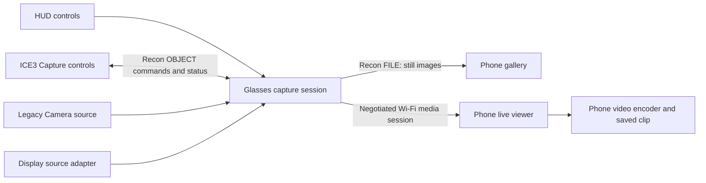

# Capture architecture and feasibility

Initial design prepared 22 November 2026, retained for the broader architecture and future options. The first implemented prototype uses Wi-Fi HTTP for control/media, a shell-UID display helper, and phone-side MP4 encoding. README, protocol and validation documents describe current behavior; proposals below are not implementation or test claims.

## Evidence available before hardware access

Paths in this table are relative to the common RecomProjects directory. They identify inspected source files, not code copied into this repository.

| Evidence | Finding | Consequence |
| --- | --- | --- |
| `NEW_Recom_Apps/Recom3JetVision/README.md`, `TEST_RESULTS.md` | Prior work reports real Jet JPEG delivery through Recon FILE, correlated OBJECT receipts and a phone foreground session | Reuse its transport conventions and lifecycle lessons; no new measurement is claimed here |
| `NEW_Recom_Apps/Recom3JetVision/VOICE_LAUNCH_RESULTS.md` | Prior work reports a phone command launching Jet photo capture; the phone app label is ice3 | Phone-triggered capture has an existing reference implementation; no voice control is required for this app |
| `snow3/app/src/main/res/values/strings.xml` and `.git` remote query | Parent Snow3 checkout uses app label ice3, package `com.recom3.snow3`, and remote `recom3/snow3` | This checkout contains the recent Vision integration |
| `NEW_Recom_Apps/snow3` remote query | Other checkout points to `recom3/Ice3` | Do not assume the two checkouts are interchangeable or merge them automatically |
| `Ice3svr/app/src/main/java/com/recom3/ice3svr/MainActivity.java` | Notification/call-helper UI | It is not the identified photo/video receiver |
| `reconcast/src/main/java/com/google/android/AndroidProjector.java` | Reads the ADB `framebuffer:` service through a desktop ADB server | Useful display reference, but not a phone-native wireless capture implementation |
| `jet/limo_apps/deprecated/ModLiveLiveServer/` | Archived service reads `/dev/graphics/fb0`, assumes 428 x 240 RGB565 and declares `android.uid.system`; its README calls it obsolete | Historical precedent, not evidence a normally installed APK has framebuffer access |
| `jet/mydroid/frameworks/base/core/res/AndroidManifest.xml` | READ_FRAME_BUFFER is signature/system protected in this source tree | A normal runtime permission request cannot grant it |
| `jet/mydroid/frameworks/native/services/surfaceflinger/SurfaceFlinger.cpp` | CAPTURE_SCREEN checks framebuffer permissions | Invoking a hidden screenshot method or screencap from an ordinary APK does not grant the missing privilege |
| `NEW_Recom_Apps/recon_sdk_frame_2/connectivity/.../IHUDScreenServiceImpl.java` | Exposes display power/state operations, not a screenshot method | HUDScreen is not a demonstrated display-capture backend |

The local firmware tree is useful implementation evidence; it does not prove the exact firmware or privileges of the units that will be tested.

## Feature matrix

| Function | Jet | Snow2 | Main unresolved dependency |
| --- | --- | --- | --- |
| Camera photo to phone | Planned; reuse legacy Camera/JPEG approach | Only if a camera is actually enumerated | Camera ownership, transport integration |
| Camera live view | Planned | Unavailable when no camera exists | Capture/encode cost and sustained link performance |
| Camera clip | Planned, initially local MP4 then transfer | Unavailable when no camera exists | Supported MediaRecorder profile, storage, clean finalization |
| Screenshot of another foreground app | Planned | Planned | Display permissions or an explicitly enabled helper |
| Live glasses display | Planned | Planned | Display source, link capacity and foreground-app coexistence |
| Video of glasses display | Planned, phone-side encoding preferred | Planned, phone-side encoding preferred | Same display source plus phone encoder |

Capabilities are reported independently. A working photo path must not imply display capture, and a working screenshot must not imply a usable video frame rate.

## Components and data flow

The glasses capture session owns all sources and exposes a strict capability model. Its background service must remain active while the user changes foreground applications. A connection loss must clear live state and release the camera/stream; it must not silently restart capture when the phone reconnects.

The ICE3 feature uses the existing Bluetooth service, a user-started foreground phone session, a preview and a local gallery. Stopping capture must not stop unrelated ICE3 synchronization or other foreground functions. API 16-compatible glasses code stays separate from phone implementation requirements.

## Camera source

Use `android.hardware.Camera` with supported parameters discovered at runtime, modeled on Jet Vision and the original CameraSample. Avoid two camera owners. Opening the camera may conflict with ReconCamera or Jet Vision; report CAMERA_BUSY and let the current owner finish.

Still-photo mode uses the JPEG callback. Initial live mode can evaluate Camera preview frames compressed to JPEG for simple bounded framing. Start conservatively at 320 x 240 / 2 fps, then test 640 x 480 / 5 fps if supported. These are test profiles, not performance promises.

Evaluate local camera clips through MediaRecorder with a device-supported profile. Finalize and verify the MP4 before transferring it. Reading a growing MediaRecorder MP4 is not an implemented streaming protocol. H.264 streaming through MediaCodec/native code is a later option only after verifying encoder formats, timestamps, API 16 behavior and OMAP-specific limits.

Camera preview from a background session and simultaneous operation with another foreground app need a physical-device gate. Do not assume that keeping a Service alive is sufficient for a usable camera preview surface.

## Display source: first implementation gate

Try only sources that the actual installation can legitimately use:

1. A vendor capture interface, if the installed firmware exposes a usable one. None has been established by the inspected HUDScreen implementation.
2. Direct framebuffer read, only if ordinary application access already permits it. Discover dimensions, format, row stride and active buffer; never reuse the archived fixed RGB565 assumptions without measurement. Test GPU/video overlays and double-buffering artifacts.
3. An optional, explicitly enabled display helper running with an already available shell/system privilege. A helper started from a PC may need restarting after reboot. Its launch, process identity, access channel, lifecycle and deployment remain undecided.
4. PC-assisted ADB framebuffer capture for diagnostics. This can validate image content, but it does not satisfy phone-only operation.

Do not change framebuffer permissions globally, replace system components, enable network ADB or adopt a shared system UID automatically. A development signature does not satisfy a platform-signature requirement. If no usable capture source exists, report SCREEN_CAPTURE_UNAVAILABLE while keeping independent camera functions available.

MediaProjection is documented as API 21+; screenrecord as Android 4.4 / API 19+. The expected Jet API 16 baseline needs another source. Confirm Snow2 firmware independently. See the linked official Android references in README.

## Media transport

Keep small commands and still photos on the known Recon OBJECT/FILE services. Preserve existing UUIDs, framing, compression and connection ownership. Add a separate action namespace rather than reusing Vision requests or invoking an AI provider.

Prefer the existing common Wi-Fi network or phone hotspot for live media, after checking whether another app already relies on that link. Do not change network roles or hotspot settings during another session. The bootstrap must negotiate a session identity and a reachable endpoint; old Android TLS/cipher support must be checked before choosing the media security implementation. No permanently open, unauthenticated media listener is acceptable. This transport is a design choice, not implemented connectivity.

Bluetooth-only fallback may support photos and a slow preview, depending on measurements. Live high-frame-rate Bluetooth video is not a baseline promise. For scale, a 428 x 240 RGBA frame is 410,880 bytes; five raw frames/s require about 16.4 Mbit/s before overhead. Compression is essential. Prior Vision end-to-end latency includes cloud work and cannot be used as a Bluetooth-only throughput benchmark.

## Display recording on the phone

Prefer encoding incoming display frames on the phone to reduce load on the glasses. Begin with native display size and a measured 2-5 fps target. Negotiate the actual dimensions; 428 x 240 is a starting reference, not a universal constant.

Use monotonic capture timestamps and preserve frame gaps. Do not speed up a recording by treating missing or late frames as continuous ideal-rate video. Record received-frame and dropped-frame counts. Finalize clips on explicit stop, connection loss, source failure or storage exhaustion; retain an incomplete-file marker if a playable clip cannot be finalized.

The initial recording is silent. Internal application audio is not supplied by framebuffer capture, and microphone audio would require a separate source and timing model.

## User interaction

Phone: connect/status, choose Camera or Glasses screen, Photo/Screenshot, Live on/off, Record/Stop, gallery and clear errors. Disable controls using negotiated capabilities and current busy state.

Glasses: compact directional-control menu, Select to capture/start/stop, Back to stop or exit as appropriate, and visible recording state when the app is shown. A global key hook is not assumed. For capturing another app from the glasses, offer a 3- or 5-second delay and return to that app before acquisition. Phone controls are the primary way to stop a display recording without covering its content. An overlay or global shortcut is optional later work with its own permissions and input-conflict validation.

Allow one active media source initially. Camera plus display capture, camera plus Android Auto, and microphone plus other audio consumers are separate concurrency tests.

## Storage and recovery

Save media locally on the phone by default with user-visible export. Use app-owned pending files, size/free-space limits, atomic completion and explicit retention. Long camera clips should use the Wi-Fi transfer path with bounded chunks rather than the existing 1 MiB still-photo envelope.

No automatic cloud upload, capture-on-reconnect or hidden background retry. Stop capture cleanly on disconnection and require an explicit new start. Preserve completed photos/clips and report a partial recording accurately.
